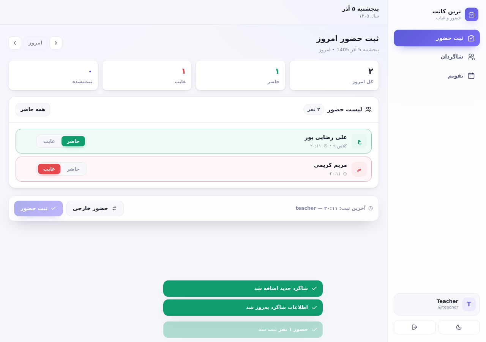
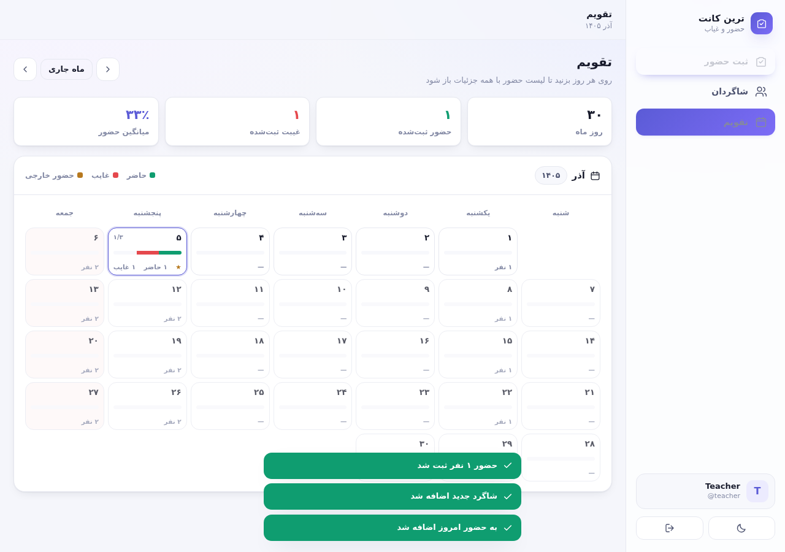
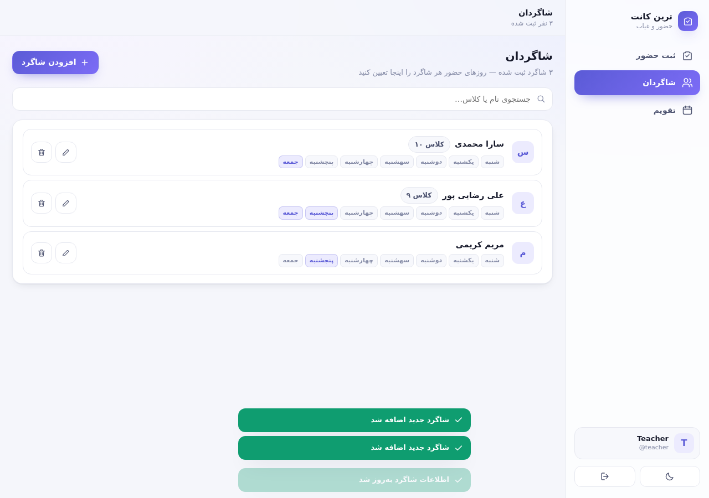
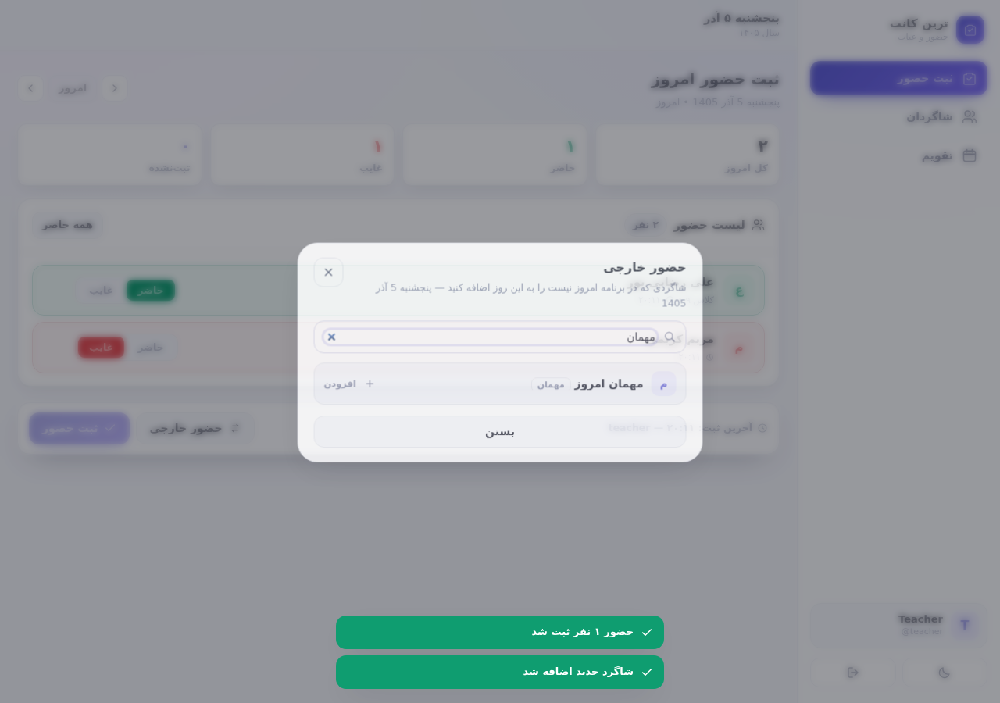
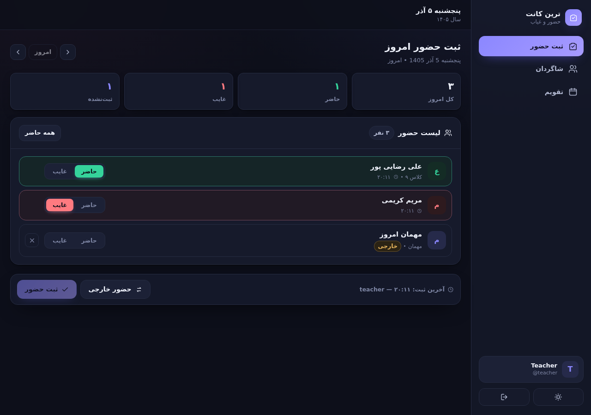
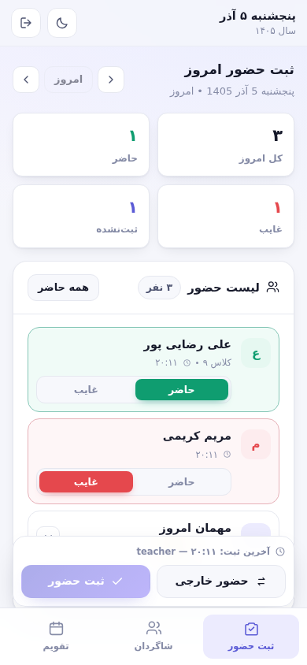
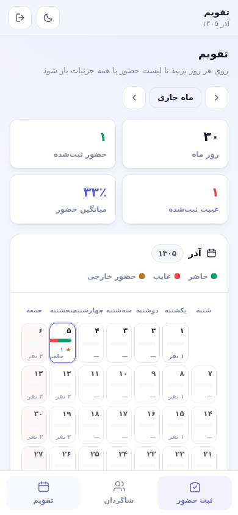

<div align="center">

# 🎓 Train Count

**A small, fast, dependency-free attendance tracker for classes and tutoring groups — with a full Persian (Jalali) calendar.**

[](LICENSE)


*Persian (RTL) interface · responsive on phone / tablet / desktop · light & dark themes*

</div>

---

## 📸 Screenshots

| Daily attendance | Jalali calendar |
|:---:|:---:|
|  |  |

| Login | Students & weekly schedule |
|:---:|:---:|
|  |  |

| Guest ("extra") attendance | Dark mode |
|:---:|:---:|
|  |  |

| Mobile | Mobile calendar |
|:---:|:---:|
|  |  |

---

## 💡 What it is

Train Count answers one question, many times a day: **“who showed up today?”**

Every student has a **weekly schedule** (for example *Saturdays only*, or *Sat + Mon + Wed*).
Each day the app automatically builds the roster of the students who are expected that day —
you just tap **Present / Absent** and press **Save**.

If someone who is *not* on today's schedule shows up anyway (a make-up lesson, a guest),
the **Extra attendance** button lets you pull any student from the full list into that day.
Everything stays in the calendar with full details: status, time, and the account that saved it.

### Features

- 🔐 **Private by design** — no sign-up route at all. Accounts are seeded once, passwords are
  stored as `scrypt` hashes, sessions are signed cookies that survive 60 days and can be revoked.
- ✅ **Daily attendance** — automatic roster, one-tap present/absent, live counters,
  “everyone present” shortcut, batch save, and **auto-save when you leave the page**
  (so nothing is ever lost).
- ➕ **Students ** — add, edit and delete students with their weekday schedule, class/grade and
  an active/inactive flag. Inactive students stay out of the automatic roster.
- 🌟 **Extra attendance** — bottom action bar, right next to *Save*: searchable list of **all**
  students; add or remove anyone for that specific day, marked with a “guest” badge.
- 📅 **Jalali (Solar Hijri) calendar** — Saturday-first month grid, a presence/absence bar per day,
  today highlighted, a star for days with guests. Tap any day to see **the full attendance sheet
  with all details**, or jump straight to editing that day.
- 🎨 **UI/UX** — RTL Persian, system font stack, light/dark theme, soft motion,
  mobile bottom tab bar, and zero horizontal overflow on small screens.
- ⚡ **Clean, fast backend** — Node's built-in `http` module, **no runtime dependencies at all**,
  atomic JSON persistence, login rate limiting, and 106 automated tests.

---

## 🚀 Quick start

Requirements: **Node.js 18+**. There is nothing to install — the project has no dependencies.

```bash
git clone https://github.com/USERNAME/train-count.git
cd train-count
npm start
```

Open <http://localhost:3000> and log in.

```bash
npm start          # run on PORT (default 3000)
npm run dev        # dev mode with auto-restart (node --watch)
npm test           # 65 logic + API checks
npm run test:ui    # 41 browser checks (needs Playwright)
```

---

## 🔑 Accounts & first run

This repository contains **no credentials**. Accounts are created on the very first run in one of two ways:

**1. Recommended — define them yourself (any number of accounts):**

```bash
export SEED_ACCOUNTS='[
  {"username":"admin","name":"Admin","password":"a-long-random-password"},
  {"username":"teacher","name":"Teacher","password":"another-long-password"}
]'
npm start
```

**2. Or let the app generate one:**

```bash
npm start
# → a fresh database is created and a random password for "admin"
#   is printed in the console exactly once. Save it.
```

You can also pick the username/name/password of that single account with
`ADMIN_USERNAME`, `ADMIN_NAME` and `ADMIN_PASSWORD`.

> Accounts are seeded **only** when `data/db.json` does not exist yet.
> To re-create them, delete that file (this also deletes all attendance data).

### Configuration

| Variable | Default | Meaning |
|---|---|---|
| `PORT` | `3000` | HTTP port |
| `HOST` | `0.0.0.0` | Bind address |
| `DATA_DIR` | `./data` | Where `db.json` and `secret.key` live |
| `SEED_ACCOUNTS` | – | JSON array of `{username, name, password}` used on first run |
| `ADMIN_USERNAME` | `admin` | Username when `SEED_ACCOUNTS` is not used |
| `ADMIN_NAME` | `Administrator` | Display name for that account |
| `ADMIN_PASSWORD` | random | Password for that account (random + printed if omitted) |

---

## 🗂 Project structure

```
train-count/
├── server.js              # the whole backend: router, auth, API, static files
├── lib/
│   └── jalali.js          # Jalali ⇄ Gregorian conversion (shared by server & browser)
├── web/
│   ├── index.html         # app shell + login screen
│   ├── styles.css         # responsive design, light/dark themes
│   └── app.js             # all UI logic (routing, modals, calendar)
├── test/
│   ├── api.test.js        # 65 API & logic checks (no dependencies)
│   └── ui.test.js         # 41 Playwright browser checks
├── docs/screenshots/      # images used in this README
├── data/                  # created at runtime: db.json + secret.key (git-ignored)
├── Dockerfile
└── package.json
```

---

## 🔌 API

Every endpoint speaks JSON. Dates are **Jalali** strings in `YYYY-MM-DD` form (e.g. `1405-09-05`).

| Method | Path | Purpose |
|---|---|---|
| `POST` | `/api/login` | `{username, password}` → session cookie |
| `POST` | `/api/logout` | Revoke the session server-side |
| `GET` | `/api/me` | Current user + today's date |
| `GET` | `/api/students` | List students |
| `POST` | `/api/students` | Create `{name, cls?, weekdays?, active?}` |
| `PATCH` | `/api/students/:id` | Partial update |
| `DELETE` | `/api/students/:id` | Delete a student and their records |
| `GET` | `/api/day?date=…` | Roster + summary for one day |
| `POST` | `/api/day/marks` | Batch save `{date, marks:{studentId:"present"\|"absent"\|"clear"}}` |
| `POST` | `/api/day/extra` | Guest attendance `{date, studentId, action:"add"\|"remove"}` |
| `GET` | `/api/calendar?year=…&month=…` | Month data for the calendar view |

`weekdays` uses **Saturday = 0 … Friday = 6**.

### Example

```bash
# log in (cookie jar)
curl -c jar.txt -H 'Content-Type: application/json' \
  -d '{"username":"admin","password":"<PASSWORD>"}' http://localhost:3000/api/login

# a student who only attends on Saturdays
curl -b jar.txt -H 'Content-Type: application/json' \
  -d '{"name":"Ali Rezaei","cls":"Grade 9","weekdays":[0]}' http://localhost:3000/api/students

# save today's attendance
curl -b jar.txt -H 'Content-Type: application/json' \
  -d '{"date":"1405-09-05","marks":{"st_xxxx":"present"}}' http://localhost:3000/api/day/marks
```

---

## 🧱 Data model

```jsonc
{
  "users":      [{ "username": "admin", "salt": "…", "passwordHash": "…" }],
  "sessions":   { "<sid>": { "u": "admin", "exp": 1765000000000 } },
  "students":   [{ "id": "st_ab12…", "name": "Ali Rezaei", "cls": "Grade 9",
                   "weekdays": [0, 2], "active": true }],
  "attendance": {
    "1405-09-05": {
      "records": { "st_ab12…": { "status": "present", "at": "2026-11-26T15:20:00.000Z", "by": "admin" } },
      "extras":  ["st_cd34…"],
      "updatedAt": "2026-11-26T15:20:00.000Z",
      "updatedBy": "admin"
    }
  }
}
```

- Writes are atomic (`tmp` file + `rename`), so a crash can never leave a half-written database.
- A corrupt `db.json` is backed up as `db.json.corrupt-<timestamp>` and a fresh one is created.
- Days with no records at all are pruned automatically — only meaningful data is kept.

---

## 🔒 Security

- Passwords: **scrypt** (64-byte key, 16-byte random salt) — never plaintext.
- Sessions: `HttpOnly` + `SameSite=Lax` cookie signed with **HMAC-SHA256**; the session id lives
  server-side, so *logout* really revokes it.
- Login throttling: 8 failures per IP+username per 10 minutes → `429`.
- Every API route except `/api/login` answers `401` without a valid session.
- Unknown usernames and wrong passwords produce the **same** error message, and the `scrypt`
  work is performed either way (no user enumeration by message or by timing).
- The login screen exposes no account hints: no placeholders, no account list.
- Path-traversal protection for static files, request body size cap, and HTML-escaping of all
  user input in the UI (XSS).
- **No sign-up route exists.** This is a private, invite-only style deployment.
- Keep `data/` out of git (already in `.gitignore`) and serve the app over **HTTPS** in production.

---

## 📅 About the Jalali calendar

`lib/jalali.js` implements bidirectional Jalali ⇄ Gregorian conversion using the Borkowski
leap-year breaks, and is shared by the server and the browser — one source of truth.
The tests convert every one of the 365 days of 1404 back and forth, and check that Nowruz of
1399–1405 lands on the correct real-world Gregorian date.

---

## 🧪 Tests

```bash
npm test          # 65 checks: calendar math, auth, CRUD, attendance, guests, calendar, persistence, security
npm run test:ui   # 41 checks in a real browser (Playwright)
```

First time only, for the UI suite:

```bash
npm i -D playwright && npx playwright install chromium
```

The browser suite really drives the app: wrong/valid login, session surviving a reload,
adding/editing/deleting students, search, marking present/absent, clearing a mark,
auto-save on navigation, guest attendance, calendar rendering and day details, day navigation,
dark mode, no horizontal overflow at 390/820/1440 px, and logout.
Both suites spawn the server against a throw-away `DATA_DIR`, so your real data is never touched.

CI (GitHub Actions) runs the API suite on Node 18/20/22 — see `.github/workflows/ci.yml`.

---

## 🚢 Deployment

### Docker

```bash
docker build -t train-count .
docker run -d -p 3000:3000 \
  -e SEED_ACCOUNTS='[{"username":"admin","name":"Admin","password":"change-me"}]' \
  -v train-count-data:/app/data --name train-count train-count
```

### PM2

```bash
npm i -g pm2
pm2 start server.js --name train-count
pm2 save
```

### Nginx

```nginx
server {
  listen 80;
  server_name attendance.example.com;
  location / {
    proxy_pass http://127.0.0.1:3000;
    proxy_set_header Host $host;
    proxy_set_header X-Real-IP $remote_addr;
  }
}
```

> ⚠️ Run it behind HTTPS (Cloudflare, Caddy, or certbot) for real use.

---

## 🤝 Contributing

Contributions are welcome! Please read [CONTRIBUTING.md](CONTRIBUTING.md).
Ideas, bug reports and pull requests are all appreciated — keep the “zero runtime dependencies”
spirit of the project.

---

## 🗺 Roadmap

- [ ] Excel/CSV export of monthly attendance
- [ ] Scheduled backups of `data/db.json`
- [ ] Multiple classes with a filter on the attendance page
- [ ] Per-absence notes (leave / sick)
- [ ] Per-student monthly report
- [ ] i18n layer (the UI is Persian/RTL today; strings are ready to be externalised)

---

## 📄 License

[MIT](LICENSE) — free to use, modify and distribute.

<div align="center"><sub>Made for teachers who would rather teach than fill spreadsheets.</sub></div>
